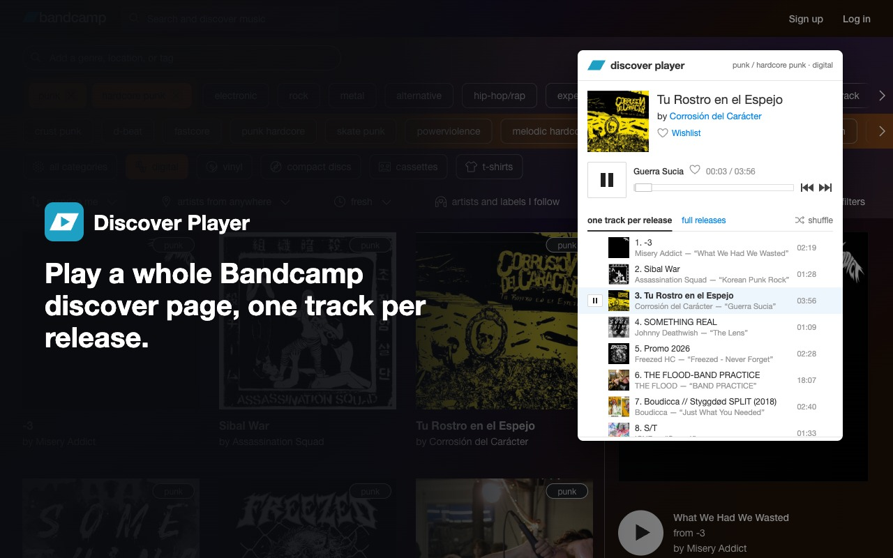
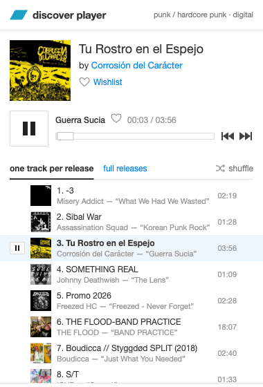
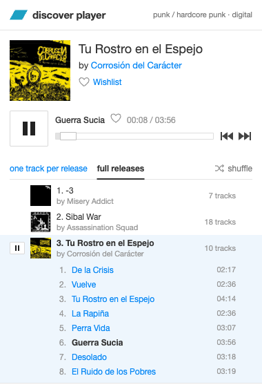

# Discover Player for Bandcamp

A browser extension for Firefox and Chrome that plays everything on a
`bandcamp.com/discover/...` page — in order or shuffled, one track per release
or whole releases. The player opens from the toolbar icon and looks like the
player on a Bandcamp release page.

> Unofficial; not affiliated with Bandcamp. It uses the internal APIs that
> Bandcamp's own pages use, so it may break if Bandcamp changes them.



## Install

- **Firefox:** [Discover Player for Bandcamp on addons.mozilla.org](https://addons.mozilla.org/addon/discover-player-for-bandcamp/)
- **Chrome:** not in the Chrome Web Store yet. Install it from a GitHub release (see below).

Then open any `bandcamp.com/discover/...` page and click the extension's toolbar icon.

<p>
  
  
</p>

### Install from a GitHub release (Chrome)

1. Download `bandcamp-discover-player-<version>-chrome.zip` from the
   [latest release](https://github.com/katokdoescode/bandcamp-discover-player/releases/latest)
   and unzip it.
2. Open `chrome://extensions` and turn on Developer mode.
3. Click "Load unpacked" and choose the unzipped folder.

Keep the folder: Chrome loads the extension from it. To update, download the new zip,
replace the folder's contents and click the reload icon on the extension's card.

To build it yourself instead, see [Development](#development).

## Features

- **play this page** — plays exactly the releases shown on the open discover page
  (including those loaded with "View more results"), then loads more by itself
  when you scroll near the end of the list or playback gets there.
- **one track per release** / **full releases** — one track from each release, or every release in full.
- **shuffle** — shuffles releases; tracks within a release stay in order.
- **you may also like** — the recommendations from the playing release's page, in a third tab; they always play
  in full, starting from the one you click.
- **play all releases** — on an artist's or label's own `<name>.bandcamp.com` pages (home, music, album or track):
  their whole discography, newest or oldest first.
- **repeat** (beta, full releases only) — loops the current release; next/previous still leave it.
- **lyrics** — shown in place of the list for tracks that have them (in both modes); they follow the playing track.
- The release year is shown next to the artist and in the list.
- After the page is reloaded (`s=rand` gives new results every time) or its filters
  change, the player offers **update list**; the current track keeps playing.
- ♡ wishlist for releases and single tracks (red when wishlisted, click again to remove).
  Needs an open bandcamp.com tab where you are logged in; otherwise it offers to log in.
- Music keeps playing after the popup closes. Media keys work; in the popup, `Space` and `Shift+←/→`.

## Development

Requires Node.js 22+.

```bash
npm install
```

```bash
npm run dev            # Chrome with the extension loaded and live reload
```

```bash
npm run dev:firefox    # the same for Firefox
```

```bash
npm run check          # types, tests, both builds and Mozilla's linter — same as CI
```

Builds go to `.output/chrome-mv3` and `.output/firefox-mv2`; `npm run zip` and
`npm run zip:firefox` package them for the stores (Firefox also gets a sources archive).

To install a build by hand:
- **Chrome:** `chrome://extensions` → Developer mode → "Load unpacked" → `.output/chrome-mv3`.
- **Firefox:** `about:debugging#/runtime/this-firefox` → "Load Temporary Add-on…" → `.output/firefox-mv2/manifest.json`.

### Building the Firefox package from source (for add-on reviewers)

Tested on macOS and Ubuntu 24.04 with Node.js 24 and npm 11.

```bash
npm ci
```

```bash
npm run zip:firefox
```

The unpacked extension is written to `.output/firefox-mv2/` and the package to
`.output/bandcamp-discover-player-<version>-firefox.zip`. The build is not minified
and is reproducible: building twice gives identical files.

## How it works

Built with [WXT](https://wxt.dev) and TypeScript. Almost all code is shared; the
browsers differ only in where the player lives and how the page's results are read.

| | Firefox (MV2) | Chrome (MV3) |
|---|---|---|
| Where audio plays | persistent background page | offscreen document; the service worker only relays messages |
| How the page's results are seen | `webRequest.filterResponseData` | a `fetch` wrapper in the page's own world (`world: "MAIN"`) |
| Requests made as the page | `content.fetch` | plain `fetch` from the content script |

Chrome closes the offscreen document after about 30 seconds of silence, so the
player's state is saved to `storage.session` and restored on the next start.

```
src/
  entrypoints/
    background.ts            background: player host in Firefox, service worker in Chrome
    offscreen/               Chrome: document with the audio element and the player
    bandcamp.content.ts      page data, requests made as the page, wishlist
    discover-hook.content.ts Chrome: reads the page's discover results
    popup/                   user interface
  lib/
    player.ts                queue, modes, shuffle, paging, wishlist
    hosts/                   browser-specific parts of the player
    discover-spec.ts         discover page filters from the URL
    captures.ts              builds the page's result list from its responses
    bandcamp.ts, page.ts     Bandcamp API and page helpers
tests/                       Vitest
```

Bandcamp endpoints used:
- `POST /api/discover/1/discover_web` — discover results;
- `GET /api/mobile/25/tralbum_details` — a release's tracklist with mp3-128 links;
- `POST /api/mobile/25/band_details` — an artist's or label's discography;
- track pages on `*.bandcamp.com` — lyrics text (read from the page's ld+json);
- release pages on `*.bandcamp.com` — the "you may also like" section;
- `POST /collect_item_cb`, `/uncollect_item_cb` — wishlist, same as the site's button.

## Releases

CI (`.github/workflows/ci.yml`) runs on every push to `main` and on pull requests:
it typechecks, runs the tests, builds both versions and runs Mozilla's linter.

After a green run on `main`, a GitHub Release with the Chrome and Firefox zips
(and the sources archive for AMO) is created automatically — if the version in
`package.json` has not been released yet. To ship a new version:

```bash
npm version patch      # or minor / major — bumps the version in package.json
```

```bash
git push --follow-tags
```

The release zips are what you upload to the Chrome Web Store and addons.mozilla.org.
Firefox only installs extensions signed by Mozilla, so the Firefox zip is what you
submit for signing, not a file for direct installation.

## Privacy

The extension collects nothing and sends nothing anywhere except requests to Bandcamp.
See [PRIVACY.md](PRIVACY.md).
